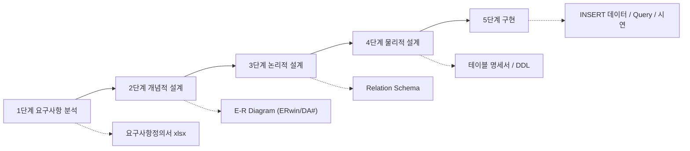
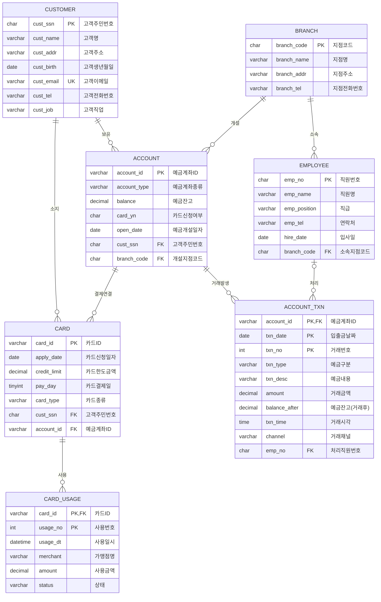

# 명지은행 데이터베이스 설계 프로젝트 — 사전기획 설계 보고서

| 항목 | 내용 |
|---|---|
| 과제명 | Database 설계 Project (명지은행 은행 업무 DB 구축) |
| 참고 자료 | `프로젝트_소개.pdf` (과제 명세), `01-1_요구사항정의서(예시).xlsx` (작성 양식 예시: 영화예매 도메인) |
| 작성 목적 | 과제 조건을 빠짐없이 충족하도록 **설계 범위·산출물·ERD·스키마·시연 계획**을 미리 확정 |
| 기준 DBMS (가정) | MySQL 8.0 (CHECK 제약, CTE, 윈도우 함수 지원) — Oracle로 바꿔도 구조는 동일 |
| 모델링 도구 | ERwin 또는 DA# (과제 지정) |

---

## 1. 과제 분석

### 1.1 과제 조건 정리 (PDF 기준)

| 구분 | 요구 내용 | 이 보고서에서 다루는 위치 |
|---|---|---|
| 설계 단계 | 요구사항 분석 → 개념적 설계 → 논리적 설계 → 물리적 설계 → 구현 | 3~7장 |
| 제출물 1 | 프로젝트 개요 | 2장 |
| 제출물 2 | 요구사항 명세서(정의서) | 3장 (엑셀 예시 양식 그대로 사용) |
| 제출물 3 | E-R Diagram (ERwin / DA#) | 4장 |
| 제출물 4 | Relation Schema | 5장 |
| 시연 1 | 테이블 입력/변경 시연 | 7.2절 |
| 시연 2 | 가상 Query로 실제 질의·데이터 추출 시연 (예시 Query 5개 처리 필수) | 7.3절 |
| 데이터 | **테이블당 최소 5개 tuple** 사전 입력 | 7.1절 |
| 자율 사항 | 명세에 없는 사항은 자율적으로 구현 가능 | 1.3절, 5.3절 |



### 1.2 엑셀 예시 파일 분석
- 시트 1개(`요구사항정의_양식`), 컬럼: **요구사항 ID | 요구사항 명 | 요구사항 상세 내용 | 요구사항 유형 | 관련 엔터티타입(검증)**
- ID 체계 `URQ001~`, 상세 내용은 번호 매긴 문장형, 유형은 `기능` 위주
- 예시가 영화예매 도메인이므로 **양식만 차용하고 내용은 은행 도메인으로 새로 작성**해야 함 → 3장 초안

### 1.3 명세에서 발견한 핵심 이슈 (설계 시 반드시 해결)

| # | 이슈 | 원인 | 해결 방안 |
|---|---|---|---|
| 1 | **Query 4의 "카드 사용 금액"을 저장할 곳이 없음** | 카드 속성에 사용금액이 없음 | `카드사용내역` 엔터티 추가 후 SUM으로 계산 |
| 2 | Query 4의 "신용 카드" 구분 | 카드 종류 값 미정의 | `카드종류` 도메인 = {신용, 체크} |
| 3 | Query 3의 "1번 계좌" 의미 모호 | 계좌 순번 속성 없음 | 해당 고객 계좌를 **개설일 순으로 정렬한 첫 번째 계좌**로 정의 (Query 2와 연계) |
| 4 | 예금계좌의 예금자이름·전화번호·이메일이 고객 정보와 중복 | 이행적 함수 종속 (계좌ID → 고객주민번호 → 이름…) | 3NF 정규화로 테이블에서 제거하고 **뷰(VIEW)로 제공** (5.3절) |
| 5 | 카드신청여부는 카드 존재 여부로 유도 가능 | 유도 속성 | 컬럼 유지 + **트리거로 자동 갱신** |
| 6 | 거래내역 식별자 = (계좌ID, 입출금날짜, 거래번호) | 복합키 | 약한 엔터티(식별 관계)로 모델링, 거래번호 = **계좌·일자별 일련번호** |
| 7 | "지점별 업무", "직원" 언급은 있으나 속성 없음 | 명세 미정 | 자율 확장: `지점`, `직원` 엔터티 추가 (완성도 가점 요소) |
| 8 | 동명이인 가능성 (이름으로 조회하는 Query) | 이름은 식별자가 아님 | 쿼리는 항상 주민번호 단위로 그룹핑 |

---

## 2. 프로젝트 개요 (제출물 1 초안)

- **배경**: 명지은행은 지점별로 예금·카드 등 기본 은행 업무를 수행하며, 고객과 직원의 원활한 업무를 위해 데이터베이스 구축이 필요하다.
- **목적**: 고객·예금계좌·입출금 거래·카드 정보를 일관성 있게 관리하고, 잔액·거래내역·카드 사용 현황 등을 신속히 조회할 수 있는 DB를 설계·구현한다.
- **범위**

| 포함 (In Scope) | 제외 (Out of Scope) |
|---|---|
| 고객, 예금계좌, 계좌 거래내역, 카드, 카드 사용내역, 지점, 직원 | 대출, 이자 계산, 외환, 인터넷뱅킹 인증 |
| 입금·출금 처리(잔고 자동 반영), 카드 발급·사용 | 실제 카드 결제대금 청구·정산 프로세스 |
| 고객/계좌/카드 조회·통계 Query | 실제 웹 서비스 개발 (선택 사항) |

- **산출물**: 프로젝트 개요서, 요구사항정의서(xlsx), E-R Diagram, Relation Schema, SQL 스크립트(DDL·DML·Query), 시연

---

## 3. 요구사항 정의서 (제출물 2 초안 — 예시 엑셀 양식 그대로)

| 요구사항 ID | 요구사항 명 | 요구사항 상세 내용 | 유형 | 관련 엔터티타입(검증) |
|---|---|---|---|---|
| URQ001 | 고객 관리 | 1. 고객은 고객주민번호로 식별한다(중복 불가).<br>2. 고객명, 고객주소, 고객생년월일, 고객이메일, 고객전화번호, 고객직업 정보를 가진다.<br>3. 주소·전화번호·이메일·직업은 수정할 수 있다.<br>4. 이메일은 고객 간 중복될 수 없다.<br>5. 동명이인을 허용하며 조회 시 주민번호로 구분한다.<br>6. 계좌 또는 카드를 보유한 고객은 삭제할 수 없다. | 기능 | 고객 |
| URQ002 | 예금계좌 관리 | 1. 예금계좌는 예금계좌ID로 식별한다.<br>2. 예금계좌종류(보통/정기/적금/저축), 예금잔고, 카드신청여부, 예금개설일자를 가진다.<br>3. 예금자이름·전화번호·이메일은 소유 고객 정보를 참조하여 제공한다.<br>4. 한 고객은 여러 계좌를 가질 수 있고, 계좌는 반드시 한 명의 고객에 속한다.<br>5. 계좌를 개설한 지점을 기록한다.<br>6. 예금잔고는 0 미만이 될 수 없다.<br>7. 고객별 계좌를 개설일 순으로 조회할 수 있다. | 기능 | 예금계좌, 고객, 지점 |
| URQ003 | 입출금 거래 관리 | 1. 모든 입금·출금은 거래 건별로 날짜와 함께 계좌에 기록한다.<br>2. 거래내역은 (예금계좌ID, 입출금날짜, 거래번호)로 식별하며, 거래번호는 계좌·일자별 일련번호이다.<br>3. 예금구분(입금/출금), 예금내용(적요), 거래금액, 거래 후 예금잔고를 기록한다.<br>4. 출금액이 잔고를 초과하면 거래를 거부한다.<br>5. 거래 기록과 잔고 갱신은 하나의 트랜잭션으로 처리한다.<br>6. 기간별(예: 최근 1개월) 거래내역을 조회할 수 있다.<br>7. 거래내역은 수정·삭제하지 않으며 정정은 반대 거래로 처리한다. | 기능 | 예금계좌거래내역, 예금계좌 |
| URQ004 | 카드 관리 | 1. 카드는 카드ID(번호)로 식별한다.<br>2. 카드신청일자, 카드한도금액, 카드결제일, 카드종류(신용/체크), 고객주민번호, 예금계좌ID를 가진다.<br>3. 연결(결제) 계좌는 카드 소유 고객 본인의 계좌여야 한다.<br>4. 카드 발급 시 연결 계좌의 카드신청여부를 'Y'로 자동 갱신한다.<br>5. 하나의 계좌에 여러 카드를 연결할 수 있다. | 기능 | 카드, 고객, 예금계좌 |
| URQ005 | 카드 사용 관리 | 1. 카드 사용 건별로 사용일시, 가맹점명, 사용금액, 상태(승인/취소)를 기록한다.<br>2. 카드별 누적 사용금액과 잔여 한도를 조회할 수 있다.<br>3. 신용카드는 한도를 초과하여 승인할 수 없다. | 기능 | 카드사용내역, 카드 |
| URQ006 | 지점·직원 관리 | 1. 지점은 지점코드로 식별하며 지점명, 주소, 전화번호를 가진다.<br>2. 직원은 직원번호로 식별하며 이름, 직급, 연락처, 입사일, 소속 지점을 가진다.<br>3. 창구 거래 시 처리 직원을 기록한다(ATM·인터넷 거래는 없음). | 기능 | 지점, 직원, 예금계좌거래내역 |
| URQ007 | 조회 및 통계 | 1. 고객명으로 보유 계좌와 현재 잔액을 조회한다.<br>2. 조회 결과를 계좌 개설 순으로 정렬한다.<br>3. 특정 고객의 첫 번째 계좌의 최근 1개월 입출금 내역을 조회한다.<br>4. 고객의 신용카드, 연결 계좌, 사용금액, 한도를 조회한다.<br>5. 생일이 가장 먼저 다가오는 고객을 조회한다.<br>6. 지점별 계좌 수·예금 총액 등 통계를 조회한다. | 기능 | 전체 |
| URQ008 | 데이터 무결성 | 1. 모든 테이블에 기본키를 지정한다.<br>2. 참조 관계는 외래키로 보장하며 거래 기록이 있는 계좌는 삭제할 수 없다.<br>3. 금액은 양수, 잔고는 0 이상, 구분값은 정해진 도메인만 허용한다. | 비기능 | 전체 |
| URQ009 | 개인정보 보호 | 1. 일반 조회 화면에서는 주민번호 뒷자리를 마스킹하여 보여준다(뷰 제공). | 비기능 | 고객 |
| URQ010 | 시연 데이터 | 1. 각 테이블에 최소 5건 이상의 데이터를 입력한다.<br>2. 날짜 데이터는 시연일 기준으로 조회 결과가 나오도록 구성한다. | 비기능 | 전체 |

---

## 4. 개념적 설계 (E-R Diagram — 제출물 3)

### 4.1 엔터티 도출

| 엔터티 | 구분 | 식별자 | 출처 |
|---|---|---|---|
| 고객 (CUSTOMER) | 강한 엔터티 | 고객주민번호 | 명세 |
| 예금계좌 (ACCOUNT) | 강한 엔터티 | 예금계좌ID | 명세 |
| 예금계좌거래내역 (ACCOUNT_TXN) | **약한 엔터티** (예금계좌에 종속) | 예금계좌ID + 입출금날짜 + 거래번호 | 명세 |
| 카드 (CARD) | 강한 엔터티 | 카드ID | 명세 |
| 카드사용내역 (CARD_USAGE) | **약한 엔터티** (카드에 종속) | 카드ID + 사용번호 | **추가** (Query 4) |
| 지점 (BRANCH) | 강한 엔터티 | 지점코드 | **추가** (자율) |
| 직원 (EMPLOYEE) | 강한 엔터티 | 직원번호 | **추가** (자율) |

### 4.2 관계 및 카디널리티

| 관계 | 엔터티 A | 엔터티 B | 카디널리티 | 참여 | 관계 유형 |
|---|---|---|---|---|---|
| 보유 | 고객 | 예금계좌 | 1 : N | 고객 부분 / 계좌 전체 | 비식별 |
| 소지 | 고객 | 카드 | 1 : N | 고객 부분 / 카드 전체 | 비식별 |
| 결제연결 | 예금계좌 | 카드 | 1 : N | 계좌 부분 / 카드 전체 | 비식별 |
| 거래발생 | 예금계좌 | 거래내역 | 1 : N | 거래내역 전체 | **식별** |
| 사용 | 카드 | 카드사용내역 | 1 : N | 사용내역 전체 | **식별** |
| 소속 | 지점 | 직원 | 1 : N | 직원 전체 | 비식별 |
| 개설 | 지점 | 예금계좌 | 1 : N | 계좌 전체 | 비식별 |
| 처리 | 직원 | 거래내역 | 1 : N | 양쪽 부분 (ATM 거래는 직원 없음) | 비식별 |

### 4.3 ERD 초안 (ERwin/DA#로 옮겨 그릴 기준안)



> [!TIP]
> ERwin에서는 **Logical 모델은 한글 엔터티/속성명**, **Physical 모델은 영문 테이블/컬럼명**으로 동시에 관리하면 개념·논리·물리 단계를 한 파일로 보여줄 수 있습니다. 식별 관계(거래발생, 사용)는 실선, 비식별 관계는 점선으로 표시됩니다.

---

## 5. 논리적 설계 (Relation Schema — 제출물 4)

### 5.1 Relation Schema (PK = **굵게**, FK = *기울임*)

- BRANCH(**branch_code**, branch_name, branch_addr, branch_tel)
- EMPLOYEE(**emp_no**, emp_name, emp_position, emp_tel, hire_date, *branch_code*)
- CUSTOMER(**cust_ssn**, cust_name, cust_addr, cust_birth, cust_email, cust_tel, cust_job)
- ACCOUNT(**account_id**, account_type, balance, card_yn, open_date, *cust_ssn*, *branch_code*)
- ACCOUNT_TXN(***account_id***, **txn_date**, **txn_no**, txn_type, txn_desc, amount, balance_after, txn_time, channel, *emp_no*)
- CARD(**card_id**, apply_date, credit_limit, pay_day, card_type, *cust_ssn*, *account_id*)
- CARD_USAGE(***card_id***, **usage_no**, usage_dt, merchant, amount, status)

외래키 참조:
- EMPLOYEE.branch_code → BRANCH, ACCOUNT.branch_code → BRANCH
- ACCOUNT.cust_ssn → CUSTOMER
- ACCOUNT_TXN.account_id → ACCOUNT, ACCOUNT_TXN.emp_no → EMPLOYEE (NULL 허용)
- CARD.(account_id, cust_ssn) → ACCOUNT.(account_id, cust_ssn) — **본인 계좌만 연결되도록 복합 FK**
- CARD.cust_ssn → CUSTOMER
- CARD_USAGE.card_id → CARD

### 5.2 함수 종속성 및 정규화 검증

| 릴레이션 | 주요 함수 종속 | 1NF | 2NF | 3NF/BCNF |
|---|---|---|---|---|
| CUSTOMER | cust_ssn → 나머지 전부, cust_email → cust_ssn (후보키) | ✔ | ✔ | ✔ |
| ACCOUNT | account_id → 나머지 전부 | ✔ | ✔ | ✔ (예금자이름 등 제거 후) |
| ACCOUNT_TXN | (account_id, txn_date, txn_no) → 나머지 전부 | ✔ | ✔ 부분종속 없음 | ✔ |
| CARD | card_id → 나머지 전부 | ✔ | ✔ | ✔ (*) |
| CARD_USAGE | (card_id, usage_no) → 나머지 전부 | ✔ | ✔ | ✔ |
| BRANCH / EMPLOYEE | 단일 PK → 나머지 전부 | ✔ | ✔ | ✔ |

(*) CARD의 cust_ssn은 명세 요구 속성이며, 계좌 소유자와의 일치를 **복합 FK로 강제**하여 중복으로 인한 이상(anomaly)이 생기지 않게 함.

### 5.3 주요 설계 결정 사항

| 결정 | 내용 | 근거 |
|---|---|---|
| D1. 예금계좌의 예금자이름·전화번호·이메일 | 테이블에서 제거, `v_account_detail` 뷰로 제공 | 3NF 준수 + 명세상 "포함" 요구도 뷰로 충족 |
| D2. 카드신청여부(card_yn) | 컬럼 유지, 카드 INSERT/DELETE 트리거로 자동 갱신 | 명세 속성 유지 + 무결성 보장 |
| D3. 예금잔고(balance) | 계좌에 현재 잔고 저장 + 거래내역에 거래 후 잔고 저장 | 명세 요구, 조회 성능. 일관성은 프로시저로 보장 |
| D4. 거래번호 | 계좌·일자별 1부터 증가하는 일련번호 | 복합 PK (계좌, 날짜, 번호)와 자연스럽게 일치 |
| D5. 카드결제일 | 매월 결제일(1~27, TINYINT) | 카드 결제일은 일반적으로 "매월 n일" 개념 |
| D6. 카드 사용금액 | `CARD_USAGE` 합계(상태='승인')로 계산 | 유도값을 저장하지 않아 불일치 방지 |
| D7. 1번 계좌 | 고객 계좌를 개설일 순 정렬 시 첫 번째 (`ROW_NUMBER()`) | Query 2와 의미 연결 |

---

## 6. 물리적 설계

### 6.1 테이블 명세 (핵심 제약 조건)

| 테이블 | 컬럼 | 타입 | 제약 |
|---|---|---|---|
| CUSTOMER | cust_ssn | CHAR(14) | PK, 형식 `YYMMDD-NNNNNNN` |
| | cust_name | VARCHAR(20) | NOT NULL |
| | cust_addr | VARCHAR(100) | NOT NULL |
| | cust_birth | DATE | NOT NULL |
| | cust_email | VARCHAR(50) | UNIQUE |
| | cust_tel | VARCHAR(15) | NOT NULL |
| | cust_job | VARCHAR(30) | NULL 허용 |
| ACCOUNT | account_id | VARCHAR(20) | PK (예: `110-234-567890`) |
| | account_type | VARCHAR(10) | CHECK IN ('보통예금','정기예금','적금','저축예금') |
| | balance | DECIMAL(15,0) | NOT NULL DEFAULT 0, CHECK ≥ 0 |
| | card_yn | CHAR(1) | DEFAULT 'N', CHECK IN ('Y','N') |
| | open_date | DATE | NOT NULL |
| | cust_ssn | CHAR(14) | FK, NOT NULL, UNIQUE(account_id, cust_ssn) |
| | branch_code | CHAR(4) | FK, NOT NULL |
| ACCOUNT_TXN | account_id, txn_date, txn_no | VARCHAR(20), DATE, INT | 복합 PK, account_id FK (ON DELETE RESTRICT) |
| | txn_type | VARCHAR(4) | CHECK IN ('입금','출금') |
| | txn_desc | VARCHAR(50) | 적요 (급여, 이체, ATM출금 …) |
| | amount | DECIMAL(15,0) | CHECK > 0 |
| | balance_after | DECIMAL(15,0) | CHECK ≥ 0 |
| | txn_time | TIME | NOT NULL |
| | channel | VARCHAR(10) | CHECK IN ('창구','ATM','인터넷','모바일') |
| | emp_no | CHAR(6) | FK, NULL 허용 |
| CARD | card_id | CHAR(19) | PK (예: `9410-1234-5678-0001`) |
| | apply_date | DATE | NOT NULL |
| | credit_limit | DECIMAL(12,0) | CHECK ≥ 0 |
| | pay_day | TINYINT | CHECK BETWEEN 1 AND 27 |
| | card_type | VARCHAR(4) | CHECK IN ('신용','체크') |
| | (account_id, cust_ssn) | | 복합 FK → ACCOUNT |
| CARD_USAGE | card_id, usage_no | CHAR(19), INT | 복합 PK, card_id FK |
| | usage_dt | DATETIME | NOT NULL |
| | merchant | VARCHAR(50) | NOT NULL |
| | amount | DECIMAL(12,0) | CHECK > 0 |
| | status | VARCHAR(4) | CHECK IN ('승인','취소') DEFAULT '승인' |
| BRANCH | branch_code | CHAR(4) | PK, branch_name UNIQUE NOT NULL |
| EMPLOYEE | emp_no | CHAR(6) | PK, branch_code FK NOT NULL, emp_position CHECK IN ('사원','대리','과장','차장','지점장') |

### 6.2 인덱스
- `customer(cust_name)` — 이름 조회 Query 1~4
- `account(cust_ssn, open_date)` — 고객별 계좌 정렬
- `card(cust_ssn)`, `card(account_id)` — FK 조인
- `customer(cust_birth)` — 생일 조회 (선택)

### 6.3 뷰 / 트리거 / 프로시저 (구현 시연 가점 요소)

| 객체 | 이름 | 역할 |
|---|---|---|
| VIEW | `v_account_detail` | 계좌 + 예금자이름·전화번호·이메일 (명세 속성 제공) |
| VIEW | `v_customer_masked` | 주민번호 뒷자리 마스킹 (`900101-1******`) |
| TRIGGER | `trg_card_ai` / `trg_card_ad` | 카드 발급·해지 시 계좌 card_yn 자동 갱신 |
| PROCEDURE | `sp_deposit(계좌, 금액, 적요, 채널, 직원)` | 계좌 잠금(FOR UPDATE) → 일련번호 채번 → 잔고 갱신 → 거래내역 INSERT를 **한 트랜잭션**으로 |
| PROCEDURE | `sp_withdraw(...)` | 위와 동일 + 잔고 부족 시 `SIGNAL SQLSTATE '45000'`으로 거부 |
| PROCEDURE | `sp_card_use(카드, 가맹점, 금액)` | 신용카드 잔여 한도 초과 시 거부 |

---

## 7. 구현 및 시연 계획

### 7.1 샘플 데이터 계획 (최소 5 tuple 조건 충족)

| 테이블 | 건수 | 시연을 위한 데이터 설계 포인트 |
|---|---|---|
| BRANCH | 5 | 인문캠퍼스점, 자연캠퍼스점, 강남점, 종로점, 수원점 |
| EMPLOYEE | 8 | 지점별 1~2명, 직급 다양화 |
| CUSTOMER | 8 | **홍길동** 포함, 생일을 시연일 근처에 분산 배치 (Query 5 검증) |
| ACCOUNT | 12 | 홍길동 **3개 계좌**(개설일 서로 다르게), 카드 없는 계좌 포함 |
| ACCOUNT_TXN | 40+ | 홍길동 1번 계좌에 **최근 1개월 내 + 1개월 이전** 거래를 섞어 필터링 효과 확인 |
| CARD | 7 | 홍길동 신용 2장 + 체크 1장 (Query 4에서 체크 제외 확인) |
| CARD_USAGE | 20 | 승인/취소 혼합, 한도 80% 이상 카드 1장 포함 |

> [!IMPORTANT]
> "과거 한달간", "다가오는 생일" Query는 **시연 당일 날짜(CURDATE())** 기준입니다. 날짜를 고정값으로 넣으면 시연일에 결과가 비어 보일 수 있으니, 거래 날짜는 `CURDATE() - INTERVAL n DAY` 형태로 입력하거나 시연 직전에 날짜를 재조정하는 스크립트를 준비하세요.

### 7.2 입력/변경 시연 시나리오

1. **신규 고객 등록** → `INSERT INTO customer …`
2. **계좌 개설** → `INSERT INTO account …` (card_yn = 'N' 확인)
3. **입금** → `CALL sp_deposit(...)` → 계좌 잔고와 거래내역(거래번호 1) 동시 반영 확인
4. **출금** → `CALL sp_withdraw(...)` → 거래번호 2 자동 채번, 잔고 감소 확인
5. **잔고 초과 출금** → 오류 발생 및 롤백 확인 (무결성 시연)
6. **카드 발급** → `INSERT INTO card …` → 트리거로 계좌 card_yn = 'Y' 변경 확인
7. **타인 계좌로 카드 연결 시도** → 복합 FK 위반 오류 확인
8. **고객 정보 변경** → `UPDATE customer SET cust_addr = …`
9. **거래내역 있는 계좌 삭제 시도** → FK RESTRICT 오류 확인

### 7.3 Query 시연 (필수 5개 SQL 초안, MySQL 8.0)

**Q1. 홍길동 고객의 모든 계좌와 현재 잔액**
```sql
SELECT c.cust_name, a.account_id, a.account_type, a.balance, a.open_date
FROM customer c
JOIN account a ON a.cust_ssn = c.cust_ssn
WHERE c.cust_name = '홍길동';
```

**Q2. Q1 결과를 계좌 개설 순으로 정렬**
```sql
SELECT c.cust_name, a.account_id, a.account_type, a.balance, a.open_date
FROM customer c
JOIN account a ON a.cust_ssn = c.cust_ssn
WHERE c.cust_name = '홍길동'
ORDER BY a.open_date, a.account_id;
```

**Q3. 홍길동 고객 1번 계좌의 과거 한 달간 입출금 내역**
```sql
WITH hong_acc AS (
  SELECT a.account_id,
         ROW_NUMBER() OVER (PARTITION BY a.cust_ssn
                            ORDER BY a.open_date, a.account_id) AS acc_seq
  FROM customer c
  JOIN account a ON a.cust_ssn = c.cust_ssn
  WHERE c.cust_name = '홍길동'
)
SELECT t.account_id, t.txn_date, t.txn_time, t.txn_no, t.txn_type,
       t.txn_desc, t.amount, t.balance_after
FROM hong_acc h
JOIN account_txn t ON t.account_id = h.account_id
WHERE h.acc_seq = 1
  AND t.txn_date BETWEEN CURDATE() - INTERVAL 1 MONTH AND CURDATE()
ORDER BY t.txn_date, t.txn_no;
```

**Q4. 홍길동 고객의 모든 신용카드, 연결 계좌, 사용 금액, 사용 한도**
```sql
SELECT k.card_id, k.account_id AS linked_account,
       k.credit_limit,
       COALESCE(SUM(CASE WHEN u.status = '승인' THEN u.amount END), 0) AS used_amount,
       k.credit_limit
         - COALESCE(SUM(CASE WHEN u.status = '승인' THEN u.amount END), 0) AS remain_limit
FROM customer c
JOIN card k ON k.cust_ssn = c.cust_ssn
LEFT JOIN card_usage u ON u.card_id = k.card_id
WHERE c.cust_name = '홍길동'
  AND k.card_type = '신용'
GROUP BY k.card_id, k.account_id, k.credit_limit;
```

**Q5. 오늘 기준 생일이 가장 먼저 다가오는 고객의 이름, 주소, 생일**
```sql
WITH bd AS (
  SELECT cust_name, cust_addr, cust_birth,
         cust_birth + INTERVAL
           (TIMESTAMPDIFF(YEAR, cust_birth, CURDATE() - INTERVAL 1 DAY) + 1) YEAR
           AS next_birthday
  FROM customer
)
SELECT cust_name, cust_addr, cust_birth, next_birthday,
       DATEDIFF(next_birthday, CURDATE()) AS d_day
FROM bd
WHERE next_birthday = (SELECT MIN(next_birthday) FROM bd);
```
- 오늘이 생일인 고객 포함(D-0), 연말→연초 넘어가는 경우 처리, 동점자 전원 출력

**추가 Query (구현 내용을 충분히 보여주기 위한 확장 제안)**

| # | 내용 | 시연 SQL 기법 |
|---|---|---|
| Q6 | 지점별 계좌 수·예금 총액 (총액 1억 이상 지점만) | GROUP BY, HAVING |
| Q7 | 카드를 하나도 보유하지 않은 고객 | NOT EXISTS |
| Q8 | 한도 사용률 80% 이상 신용카드 | 집계 + 비율 계산 |
| Q9 | 고객별 최근 1개월 입금 합계 / 출금 합계 | 조건부 집계 (CASE) |
| Q10 | 총 잔고 기준 고객 순위 Top 3 | RANK() 윈도우 함수 |
| Q11 | 계좌 잔고 = 마지막 거래 후 잔고 일치 검증 | 상관 서브쿼리 (무결성 점검) |

---

## 8. 일정(WBS) 및 산출물 구성

| 주차 | 작업 | 산출물 |
|---|---|---|
| 1주차 | 요구사항 분석, 엔터티·관계 확정 | 요구사항정의서.xlsx, 프로젝트 개요 |
| 2주차 | ERD 작성 (ERwin/DA#), 리뷰 | ERD 파일 + 이미지 |
| 3주차 | Relation Schema, 정규화 검증, 테이블 명세 | Relation Schema 문서 |
| 4주차 | DDL·뷰·트리거·프로시저 구현, 샘플 데이터 입력 | SQL 스크립트 |
| 5주차 | Query 작성·검증, 시연 리허설 | Query 스크립트, 시연 시나리오 |

권장 폴더 구조 (`c:\Users\joons\database_pr`):
```
database_pr/
├─ docs/
│  ├─ 01_프로젝트개요.docx
│  ├─ 02_요구사항정의서.xlsx
│  ├─ 03_ERD.erwin  (+ ERD.png)
│  └─ 04_RelationSchema.docx
└─ sql/
   ├─ 01_create_tables.sql
   ├─ 02_views_triggers.sql
   ├─ 03_procedures.sql
   ├─ 04_insert_sample_data.sql
   ├─ 05_demo_dml.sql
   └─ 06_queries.sql
```

---

## 9. 리스크 및 최종 체크리스트

| 리스크 | 대응 |
|---|---|
| 시연일 기준 날짜 Query 결과 없음 | 상대 날짜 INSERT 또는 날짜 재조정 스크립트 |
| 2월 29일생 생일 계산 | MySQL은 평년에 2/28로 계산됨 — 보고서에 처리 방식 명시 |
| 동명이인으로 Query 결과 혼재 | 주민번호 기준 PARTITION/GROUP BY |
| 잔고와 거래내역 불일치 | 입출금은 반드시 프로시저 경유, Q11로 검증 |
| 주민번호 PK의 개인정보 이슈 | 명세 준수하되 마스킹 뷰 제공, 보고서에 한계로 기술 |

**제출 전 체크리스트**
- [ ] 프로젝트 개요 작성
- [ ] 요구사항정의서 (예시 양식 5개 컬럼 유지, 관련 엔터티 검증 컬럼 채움)
- [ ] ERD (ERwin/DA#, 식별/비식별 관계 구분, 카디널리티 표시)
- [ ] Relation Schema (PK/FK 표기, 정규화 근거)
- [ ] 모든 테이블 5 tuple 이상
- [ ] 입력/변경 시연 스크립트
- [ ] 예시 Query 5개 + 확장 Query 정상 실행 확인

---

## 10. 확인이 필요한 사항

1. **DBMS**: 수업에서 사용하는 DBMS가 MySQL인지 Oracle인지 (SQL 문법 일부 차이)
2. **확장 엔터티**: 지점·직원 추가를 유지할지, 명세 엔터티만으로 최소 구성할지
3. **예금자이름·전화·이메일 처리**: 정규화(뷰 제공)안 vs 명세 그대로 컬럼 유지안
4. **시연 방식**: SQL 직접 실행(Workbench 등) vs 미리 정의된 Query를 선택하는 간단한 프로그램
