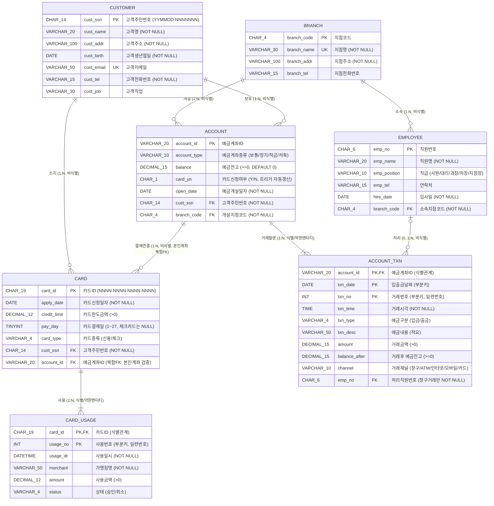
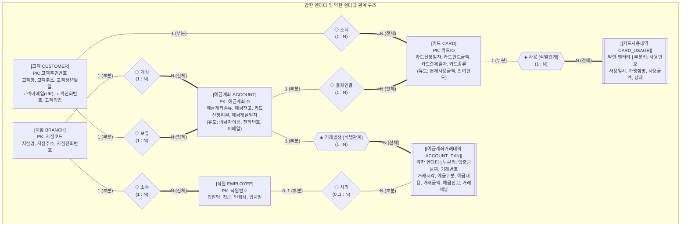

# 3. 개념적 설계 — E-R Diagram (Conceptual Design)

> **과제 제출물 3**: 요구사항 정의서를 바탕으로 DBMS에 독립적인 개념적 구조(Conceptual Schema)를 설계한 문서이다. 강의 자료의 ER 모델 원칙 및 ERwin / DA# 표기법(IE Crow's Foot)과 피터 첸(Peter Chen) 표기법을 모두 수록하였다.

---

## 3.1 개체(Entity) 도출 및 분류

요구사항 명세서(URQ001~URQ010)로부터 도출한 총 **7개의 엔터티 타입(강한 엔터티 5개, 약한 엔터티 2개)**은 다음과 같다.

| 번호 | 엔터티 한글명 | 엔터티 영문명 | 엔터티 유형 | 식별자 (Key / Partial Key) | 도출 근거 (요구사항) |
|---|---|---|---|---|---|
| 1 | **고객** | `CUSTOMER` | 강한 엔터티 (Strong Entity) | `고객주민번호` (`cust_ssn`) | 요구사항 2, URQ001 |
| 2 | **예금계좌** | `ACCOUNT` | 강한 엔터티 (Strong Entity) | `예금계좌ID` (`account_id`) | 전제 1, 요구사항 4, URQ002 |
| 3 | **예금계좌거래내역** | `ACCOUNT_TXN` | **약한 엔터티 (Weak Entity)** *(소유 엔터티: 예금계좌)* | 소유키 `예금계좌ID` + 구분자(부분키) `입출금날짜`, `거래번호` | 전제 2·3, 요구사항 5, URQ003 |
| 4 | **카드** | `CARD` | 강한 엔터티 (Strong Entity) | `카드ID` (`card_id`) | 요구사항 3, URQ004 |
| 5 | **카드사용내역** | `CARD_USAGE` | **약한 엔터티 (Weak Entity)** *(소유 엔터티: 카드)* | 소유키 `카드ID` + 구분자(부분키) `사용번호` | 필수 Query 4 ("현재까지의 사용 금액"), URQ005 |
| 6 | **지점** | `BRANCH` | 강한 엔터티 (Strong Entity) | `지점코드` (`branch_code`) | 도입부 ("지점별로 은행 업무 수행"), URQ006 |
| 7 | **직원** | `EMPLOYEE` | 강한 엔터티 (Strong Entity) | `직원번호` (`emp_no`) | 도입부 ("직원은 고객 업무를 도와 수행"), URQ006 |

---

## 3.2 속성(Attribute) 상세 분석 및 분류

ER 모델 이론에 따라 각 엔터티의 속성을 **키 여부(Key / Partial Key)**, **구조(단순 Simple / 복합 Composite)**, **값의 수(단일값 Single-valued / 다중값 Multivalued)**, **유도 여부(저장 Stored / 유도 Derived)**로 분류하였다.

### 1) 고객 (`CUSTOMER`)
| 속성 한글명 | 속성 영문명 | 키 구분 | 속성 특성 | 설명 및 도메인 규칙 |
|---|---|---|---|---|
| **고객주민번호** | `cust_ssn` | **기본키 (PK)** | 단순, 단일값, 저장 | 고객 고유 식별자 (`YYMMDD-NNNNNNN`) |
| 고객명 | `cust_name` | 일반 속성 | 단순, 단일값, 저장 | 고객 성명 (동명이인 가능) |
| 고객주소 | `cust_addr` | 일반 속성 | 단순, 단일값, 저장 | 거주지 주소 |
| 고객생년월일 | `cust_birth` | 일반 속성 | 단순, 단일값, 저장 | 출생일자 (`DATE`, 주민번호 앞 6자리와 일치) |
| 고객이메일 | `cust_email` | 후보키 (AK/UK) | 단순, 단일값, 저장 | 이메일 주소 (고객 간 중복 불가) |
| 고객전화번호 | `cust_tel` | 일반 속성 | 단순, 단일값, 저장 | 휴대폰/연락처 번호 |
| 고객직업 | `cust_job` | 일반 속성 | 단순, 단일값, 저장 | 직업 정보 (선택 입력) |

### 2) 예금계좌 (`ACCOUNT`)
| 속성 한글명 | 속성 영문명 | 키 구분 | 속성 특성 | 설명 및 도메인 규칙 |
|---|---|---|---|---|
| **예금계좌ID** | `account_id` | **기본키 (PK)** | 단순, 단일값, 저장 | 계좌 고유 번호 (예: `110-201-334455`) |
| 예금계좌종류 | `account_type` | 일반 속성 | 단순, 단일값, 저장 | `보통예금`, `정기예금`, `적금`, `저축예금` |
| 예금잔고 | `balance` | 일반 속성 | 단순, 단일값, 저장 | 현재 계좌 잔액 (0원 이상, 거래 발생 시 동기 갱신) |
| 카드신청여부 | `card_yn` | 일반 속성 | 단순, 단일값, 저장(트리거 동기화) | 연결 카드 존재 여부 (`Y` / `N`) |
| 예금개설일자 | `open_date` | 일반 속성 | 단순, 단일값, 저장 | 계좌 개설일 (`DATE`) |
| *(예금자이름)* | *(depositor_name)* | — | **유도 속성 (Derived)** | 소유 `고객.고객명` 참조 (`v_account_detail` 뷰 제공) |
| *(전화번호)* | *(depositor_tel)* | — | **유도 속성 (Derived)** | 소유 `고객.고객전화번호` 참조 (`v_account_detail` 뷰 제공) |
| *(이메일)* | *(depositor_email)* | — | **유도 속성 (Derived)** | 소유 `고객.고객이메일` 참조 (`v_account_detail` 뷰 제공) |

> **설계 노트**: 과제 명세 요구사항 4의 `예금자이름, 전화번호, 이메일`은 개념적 모델에서는 소유 고객으로부터 유도되는 속성(Derived Attribute)으로 표현하고, 논리·물리적 설계에서는 제3정규형(3NF) 만족을 위해 기본 테이블 중복 저장을 배제한 뒤 **뷰(`v_account_detail`)**로 완벽히 제공한다.

### 3) 예금계좌거래내역 (`ACCOUNT_TXN`) — *약한 엔터티*
| 속성 한글명 | 속성 영문명 | 키 구분 | 속성 특성 | 설명 및 도메인 규칙 |
|---|---|---|---|---|
| *(예금계좌ID)* | `account_id` | **소유 엔터티 PK (FK)** | 단순, 단일값, 저장 | 거래가 발생한 예금계좌 식별자 |
| **입출금날짜** | `txn_date` | **구분자 / 부분키 (Discriminator)** | 단순, 단일값, 저장 | 입금 또는 출금이 발생한 일자 (`DATE`) |
| **거래번호** | `txn_no` | **구분자 / 부분키 (Discriminator)** | 단순, 단일값, 저장 | 해당 계좌·일자 내 거래 일련번호 (`1, 2, 3, ...`) |
| 거래시각 | `txn_time` | 일반 속성 | 단순, 단일값, 저장 | 거래 발생 시각 (`TIME`) |
| 예금구분 | `txn_type` | 일반 속성 | 단순, 단일값, 저장 | `입금` 또는 `출금` |
| 예금내용 | `txn_desc` | 일반 속성 | 단순, 단일값, 저장 | 거래 적요 (급여, ATM출금, 이체, 체크카드 등) |
| 거래금액 | `amount` | 일반 속성 | 단순, 단일값, 저장 | 입금 또는 출금 금액 (> 0) |
| 예금잔고(거래후) | `balance_after` | 일반 속성 | 단순, 단일값, 저장 | 해당 거래 직후의 계좌 잔액 (≥ 0) |
| 거래채널 | `channel` | 일반 속성 | 단순, 단일값, 저장 | `창구`, `ATM`, `인터넷`, `모바일`, `카드` |

### 4) 카드 (`CARD`)
| 속성 한글명 | 속성 영문명 | 키 구분 | 속성 특성 | 설명 및 도메인 규칙 |
|---|---|---|---|---|
| **카드ID** | `card_id` | **기본키 (PK)** | 단순, 단일값, 저장 | 카드 고유 번호 (`NNNN-NNNN-NNNN-NNNN`) |
| 카드신청일자 | `apply_date` | 일반 속성 | 단순, 단일값, 저장 | 카드 발급 신청일 (`DATE`) |
| 카드한도금액 | `credit_limit` | 일반 속성 | 단순, 단일값, 저장 | 신용카드 월 사용한도 / 체크카드 1회 결제한도 (> 0) |
| 카드결제일자 | `pay_day` | 일반 속성 | 단순, 단일값, 저장 | 신용카드 매월 결제일 (`1~27`, 체크카드는 `NULL`) |
| 카드종류 | `card_type` | 일반 속성 | 단순, 단일값, 저장 | `신용` 또는 `체크` |
| *(현재사용금액)* | *(used_amount)* | — | **유도 속성 (Derived)** | `카드사용내역` 중 `승인` 건 합계 (`v_card_status` 뷰 및 Q4) |

### 5) 카드사용내역 (`CARD_USAGE`) — *약한 엔터티*
| 속성 한글명 | 속성 영문명 | 키 구분 | 속성 특성 | 설명 및 도메인 규칙 |
|---|---|---|---|---|
| *(카드ID)* | `card_id` | **소유 엔터티 PK (FK)** | 단순, 단일값, 저장 | 사용한 카드의 식별자 |
| **사용번호** | `usage_no` | **구분자 / 부분키 (Discriminator)** | 단순, 단일값, 저장 | 카드별 사용 일련번호 (`1, 2, 3, ...`) |
| 사용일시 | `usage_dt` | 일반 속성 | 단순, 단일값, 저장 | 카드 결제 일시 (`DATETIME`) |
| 가맹점명 | `merchant` | 일반 속성 | 단순, 단일값, 저장 | 결제 가맹점 상호 |
| 사용금액 | `amount` | 일반 속성 | 단순, 단일값, 저장 | 결제 금액 (> 0) |
| 상태 | `status` | 일반 속성 | 단순, 단일값, 저장 | `승인` 또는 `취소` |

### 6) 지점 (`BRANCH`) 및 직원 (`EMPLOYEE`)
| 엔터티 | 속성 한글명 | 속성 영문명 | 키 구분 | 설명 |
|---|---|---|---|---|
| **지점** | **지점코드** | `branch_code` | **기본키 (PK)** | 지점 고유 코드 (`B001`~`B005`) |
| 지점 | 지점명 | `branch_name` | 후보키 (UK) | 지점 명칭 (예: 인문캠퍼스지점) |
| 지점 | 지점주소 / 전화번호 | `branch_addr`, `branch_tel` | 일반 속성 | 지점 소재지 및 대표 전화번호 |
| **직원** | **직원번호** | `emp_no` | **기본키 (PK)** | 직원 고유 사번 (`E00001`~) |
| 직원 | 직원명 / 직급 / 연락처 / 입사일 | `emp_name`, `emp_position`, `emp_tel`, `hire_date` | 일반 속성 | 직급 도메인: `사원`, `대리`, `과장`, `차장`, `지점장` |

---

## 3.3 관계(Relationship) 정의 및 제약조건

엔터티 간 총 **8개의 이진 관계(Binary Relationship)**를 정의하였다.

| 관계명 | 엔터티 A (1측) | 엔터티 B (N측) | 카디널리티 | 참여 제약조건 (A : B) | 식별/비식별 | 업무 규칙 설명 |
|---|---|---|---|---|---|---|
| **보유** (`OWNS`) | 고객 | 예금계좌 | `1 : N` | 부분(Partial) : **전체(Total)** | 비식별 (점선) | 한 고객은 여러 계좌를 개설할 수 있으며, 모든 계좌는 반드시 한 명의 소유 고객이 존재한다. |
| **소지** (`HOLDS`) | 고객 | 카드 | `1 : N` | 부분(Partial) : **전체(Total)** | 비식별 (점선) | 한 고객은 여러 카드를 발급받을 수 있으며, 모든 카드는 반드시 한 명의 소유 고객이 존재한다. |
| **결제연결** (`LINKS_TO`) | 예금계좌 | 카드 | `1 : N` | 부분(Partial) : **전체(Total)** | 비식별 (점선) | 모든 카드는 대금 결제(또는 즉시 출금)를 위해 본인 소유의 예금계좌 1개와 반드시 연결된다. |
| **거래발생** (`HAS_TXN`) | 예금계좌 | **예금계좌거래내역** | `1 : N` | 부분(Partial) : **전체(Total)** | **식별 (실선)** | 거래내역은 예금계좌 없이는 존재할 수 없는 약한 엔터티이며, `예금계좌ID`를 기본키의 일부로 상속받는다. |
| **사용** (`HAS_USAGE`) | 카드 | **카드사용내역** | `1 : N` | 부분(Partial) : **전체(Total)** | **식별 (실선)** | 카드사용내역은 카드 없이는 존재할 수 없는 약한 엔터티이며, `카드ID`를 기본키의 일부로 상속받는다. |
| **소속** (`BELONGS_TO`) | 지점 | 직원 | `1 : N` | 부분(Partial) : **전체(Total)** | 비식별 (점선) | 한 지점에는 여러 직원이 근무하며, 모든 직원은 반드시 하나의 지점에 소속된다. |
| **개설** (`OPENS_AT`) | 지점 | 예금계좌 | `1 : N` | 부분(Partial) : **전체(Total)** | 비식별 (점선) | 모든 예금계좌는 개설을 담당한 관리 지점을 가진다. |
| **처리** (`HANDLES`) | 직원 | 예금계좌거래내역 | `1 : N` | 부분(Partial) : 부분(Partial) | 비식별 (점선) | 창구 거래는 처리 직원이 기록되나, ATM·인터넷·모바일·카드 거래는 처리 직원이 없다(`NULL` 허용). |

---

## 3.4 개념적/논리적 E-R Diagram (IE / Crow's Foot 표기법 — ERwin·DA# 기준)

---

## 3.5 개념적 E-R 구조도 (Peter Chen 표기법 대응 개념도)

강의 자료의 ER 모델 원형 표기법(강한 엔터티=`[ ]`, 약한 엔터티=`[[ ]]`, 관계=`◇`, 식별 관계=`◈`, 유도 속성=`(점선)`)을 구조화한 개념도는 다음과 같다.

*(이중 실선 `===` 은 전체 참여(Total Participation), 단일 실선 `---` 은 부분 참여(Partial Participation)를 의미함)*

---

## 3.6 ERwin / DA# 모델러 작성을 위한 실무 가이드

과제 참고 자료(6페이지)에 안내된 **ERwin Data Modeler** 또는 **DA# (Data Architect)** 도구를 사용할 때 아래 규칙대로 입력하면 위 설계와 100% 동일한 다이어그램 및 DDL이 자동 생성된다.

1. **Logical / Physical 동시 모델링 설정**
   - `Model Type`: **Logical/Physical** 선택, `Target Server`: **MySQL 8.x** 지정
   - Logical 뷰에는 **한글 엔터티명·속성명**(예: `예금계좌`, `예금계좌거래내역`), Physical 뷰에는 **영문 테이블명·컬럼명**(예: `account`, `account_txn`) 입력
2. **식별 관계(Identifying Relationship) vs 비식별 관계(Non-Identifying Relationship) 구분**
   - **식별 관계(실선, 모서리가 둥근 사각형)**:
     - `예금계좌 (1) ───< 예금계좌거래내역 (N)` → `account_id`가 자식 테이블의 PK 영역(위쪽 칸)으로 자동 상속됨 (`txn_date`, `txn_no`를 추가 PK로 체크)
     - `카드 (1) ───< 카드사용내역 (N)` → `card_id`가 자식 테이블의 PK 영역으로 자동 상속됨 (`usage_no`를 추가 PK로 체크)
   - **비식별 관계(점선, 직각 사각형)**:
     - `고객 ┄┄┄< 예금계좌` (`Nulls: No NULLs` 설정 → 필수 참여)
     - `고객 ┄┄┄< 카드` (`Nulls: No NULLs`)
     - `예금계좌 ┄┄┄< 카드` (`Nulls: No NULLs`, Alternate Key `(account_id, cust_ssn)` 참조로 Role Name 설정)
     - `지점 ┄┄┄< 직원` (`Nulls: No NULLs`)
     - `지점 ┄┄┄< 예금계좌` (`Nulls: No NULLs`)
     - `직원 ┄┄┄< 예금계좌거래내역` (`Nulls: Nulls Allowed` 설정 → 선택 참여, ATM/인터넷 거래 허용)
3. **Reverse Engineering(역공학) 기능 활용 팁**
   - ERwin 또는 MySQL Workbench(`Database > Reverse Engineer`)에서 본 프로젝트의 [`sql/01_create_tables.sql`](file:///c:/Users/joons/database_pr/sql/01_create_tables.sql) 파일을 불러오면 7개 테이블과 모든 PK/FK 관계선이 즉시 다이어그램으로 자동 생성된다.

