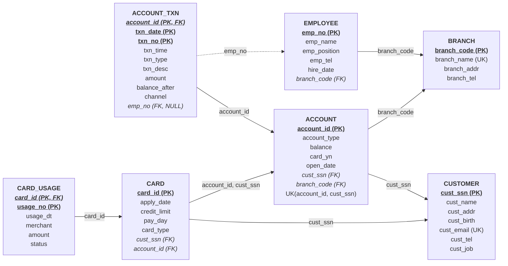

# 4. 논리적·물리적 설계 — Relation Schema

> **과제 제출물 4**: 강의 자료(*Database Design Using ER Model – Reduction to Relation Schemas*)의 변환 규칙에 따라 개념적 E-R 모델을 관계형 스키마(Relation Schema)로 변환하고, 함수 종속성 분석 및 제3정규형(3NF)/BCNF 정규화를 완료한 문서이다.

---

## 4.1 E-R 모델의 릴레이션 스키마 변환 규칙 (Reduction to Relation Schemas)

| 단계 | ER 모델 구성요소 | 변환 규칙 (Reduction Rule) | 변환 결과 릴레이션 |
|---|---|---|---|
| **Step 1** | **강한 엔터티 타입** (Strong Entity Types) | 각 강한 엔터티에 대해 하나의 릴레이션을 생성하고, 엔터티의 기본키를 릴레이션의 PK로 지정한다. (유도 속성은 스키마에서 제외하고 뷰로 구현) | `BRANCH`, `EMPLOYEE`, `CUSTOMER`, `ACCOUNT`, `CARD` |
| **Step 2** | **약한 엔터티 타입** (Weak Entity Types) | 소유 엔터티(Owner Entity)의 기본키를 외래키(FK)로 포함하고, **소유 엔터티의 PK + 자신의 구분자(Partial Key)**를 결합하여 복합 기본키(Composite PK)로 지정한다. | `ACCOUNT_TXN` — PK: `(account_id, txn_date, txn_no)` `CARD_USAGE` — PK: `(card_id, usage_no)` |
| **Step 3** | **1 : N 이진 관계** (Binary 1:N Relationships) | `N`측(전체/부분 참여) 릴레이션에 `1`측 릴레이션의 기본키를 외래키(FK)로 추가한다. | • `EMPLOYEE.branch_code` → `BRANCH` • `ACCOUNT.branch_code` → `BRANCH` • `ACCOUNT.cust_ssn` → `CUSTOMER` • `CARD.cust_ssn` → `CUSTOMER` • `CARD.(account_id, cust_ssn)` → `ACCOUNT` • `ACCOUNT_TXN.emp_no` → `EMPLOYEE` *(NULL 허용)* |

---

## 4.2 논리적 Relation Schema 명세

> **표기 규칙**: **<u>굵은 밑줄</u>** = 기본키(Primary Key, PK) / *기울임꼴* = 외래키(Foreign Key, FK) / **<u>*굵은 밑줄 기울임꼴*</u>** = 기본키이자 외래키(Identifying FK, PK/FK) / `[UK]` = 대체키(Unique Key)

### 1) 한글 논리 스키마 (Logical Relation Schema)

1. **지점** ( **<u>지점코드</u>**, 지점명`[UK]`, 지점주소, 지점전화번호 )
2. **직원** ( **<u>직원번호</u>**, 직원명, 직급, 연락처, 입사일, *소속지점코드* )
3. **고객** ( **<u>고객주민번호</u>**, 고객명, 고객주소, 고객생년월일, 고객이메일`[UK]`, 고객전화번호, 고객직업 )
4. **예금계좌** ( **<u>예금계좌ID</u>**, 예금계좌종류, 예금잔고, 카드신청여부, 예금개설일자, *고객주민번호*, *개설지점코드* )
   - 후보키(복합 UK): `(예금계좌ID, 고객주민번호)` — 카드 테이블의 본인 계좌 검증 참조용
5. **예금계좌거래내역** ( **<u>*예금계좌ID*</u>**, **<u>입출금날짜</u>**, **<u>거래번호</u>**, 거래시각, 예금구분, 예금내용, 거래금액, 예금잔고(거래후), 거래채널, *처리직원번호* )
6. **카드** ( **<u>카드ID</u>**, 카드신청일자, 카드한도금액, 카드결제일자, 카드종류, *고객주민번호*, *예금계좌ID* )
7. **카드사용내역** ( **<u>*카드ID*</u>**, **<u>사용번호</u>**, 사용일시, 가맹점명, 사용금액, 상태 )

---

### 2) 영문 물리 스키마 (Physical Relation Schema)

$$\begin{aligned}
\text{BRANCH} &\ (\underline{\mathbf{branch\_code}},\ \text{branch\_name}_{[\text{UK}]},\ \text{branch\_addr},\ \text{branch\_tel}) \\[4pt]
\text{EMPLOYEE} &\ (\underline{\mathbf{emp\_no}},\ \text{emp\_name},\ \text{emp\_position},\ \text{emp\_tel},\ \text{hire\_date},\ \mathit{branch\_code}) \\[4pt]
\text{CUSTOMER} &\ (\underline{\mathbf{cust\_ssn}},\ \text{cust\_name},\ \text{cust\_addr},\ \text{cust\_birth},\ \text{cust\_email}_{[\text{UK}]},\ \text{cust\_tel},\ \text{cust\_job}) \\[4pt]
\text{ACCOUNT} &\ (\underline{\mathbf{account\_id}},\ \text{account\_type},\ \text{balance},\ \text{card\_yn},\ \text{open\_date},\ \mathit{cust\_ssn},\ \mathit{branch\_code}) \\[4pt]
\text{ACCOUNT\_TXN} &\ (\underline{\mathbf{\mathit{account\_id}}},\ \underline{\mathbf{txn\_date}},\ \underline{\mathbf{txn\_no}},\ \text{txn\_time},\ \text{txn\_type},\ \text{txn\_desc},\ \text{amount},\ \text{balance\_after},\ \text{channel},\ \mathit{emp\_no}) \\[4pt]
\text{CARD} &\ (\underline{\mathbf{card\_id}},\ \text{apply\_date},\ \text{credit\_limit},\ \text{pay\_day},\ \text{card\_type},\ \mathit{cust\_ssn},\ \mathit{account\_id}) \\[4pt]
\text{CARD\_USAGE} &\ (\underline{\mathbf{\mathit{card\_id}}},\ \underline{\mathbf{usage\_no}},\ \text{usage\_dt},\ \text{merchant},\ \text{amount},\ \text{status})
\end{aligned}$$

---

### 3) Relation Schema 참조 무결성 다이어그램 (Schema Diagram)

---

## 4.3 함수 종속성(FD) 분석 및 정규화(Normalization) 검증

### 1) 예금계좌(`ACCOUNT`)의 이행적 함수 종속 제거 (3NF 정규화 핵심 사례)
과제 명세 요구사항 4 원문에서는 예금계좌의 속성으로 `(예금계좌ID, 예금계좌종류, 예금잔고, 카드신청여부, 예금개설일자, 예금자이름, 전화번호, 이메일, 고객주민번호)`를 제시하였다. 이를 단일 테이블에 그대로 저장하면 다음과 같은 **이행적 함수 종속(Transitive Functional Dependency)**이 발생한다.

$$\text{account\_id} \longrightarrow \text{cust\_ssn} \longrightarrow \{\text{depositor\_name},\ \text{depositor\_tel},\ \text{depositor\_email}\}$$

- **발생하는 이상 현상 (Anomalies)**:
  - **갱신 이상 (Update Anomaly)**: 홍길동 고객이 전화번호나 이메일을 변경할 때, 보유한 3개 계좌의 전화번호·이메일을 모두 찾아 수정하지 않으면 데이터 불일치가 발생한다.
  - **삭제 이상 / 삽입 이상**: 이미 `CUSTOMER` 테이블에 존재하는 정보가 `ACCOUNT`마다 중복 저장되어 저장 공간을 낭비한다.
- **3NF 정규화 분해 및 뷰(VIEW) 제공**:
  - `ACCOUNT` 테이블에서는 `cust_ssn`(FK)만 유지하고 `depositor_name, depositor_tel, depositor_email`을 제거하여 **BCNF**를 달성한다.
  - 동시에 과제 명세의 요구 속성을 그대로 조회할 수 있도록 `ACCOUNT`와 `CUSTOMER`를 조인한 **`v_account_detail` 뷰**를 생성하여 정규화와 요구사항 충족을 동시에 달성하였다.

### 2) 카드(`CARD`)의 소유자-연결계좌 일치 보장
과제 명세 요구사항 3에 의해 `CARD`는 `cust_ssn`과 `account_id`를 모두 가진다. 이때 $\text{account\_id} \rightarrow \text{cust\_ssn}$ 종속성이 존재하므로, 카드 소유자(`CARD.cust_ssn`)와 연결 계좌 소유자(`ACCOUNT.cust_ssn`)가 달라지는 무결성 모순을 막기 위해 `ACCOUNT(account_id, cust_ssn)`에 복합 UNIQUE 제약조건을 설정하고, `CARD(account_id, cust_ssn)`이 이를 **복합 외래키(Composite FK)**로 참조하도록 설계하였다.

### 3) 전체 릴레이션 정규화 수준 요약

| 릴레이션 | 후보키 (Candidate Keys) | 주요 함수 종속성 (FD) | 1NF | 2NF | 3NF / BCNF |
|---|---|---|---|---|---|
| `BRANCH` | `branch_code`, `branch_name` | 모든 비주요 속성이 두 후보키에 완전 함수 종속 | 충족 | 충족 | **BCNF** |
| `EMPLOYEE` | `emp_no` | `emp_no → {emp_name, emp_position, emp_tel, hire_date, branch_code}` | 충족 | 충족 | **BCNF** |
| `CUSTOMER` | `cust_ssn`, `cust_email` | 모든 비주요 속성이 후보키에 완전 함수 종속, 이행 종속 없음 | 충족 | 충족 | **BCNF** |
| `ACCOUNT` | `account_id` | `account_id → {account_type, balance, card_yn, open_date, cust_ssn, branch_code}` | 충족 | 충족 | **BCNF** |
| `ACCOUNT_TXN` | `(account_id, txn_date, txn_no)` | 복합키 전체에만 종속 (부분 함수 종속 없음, 이행 종속 없음) | 충족 | 충족 | **BCNF** |
| `CARD` | `card_id` | `card_id → {apply_date, credit_limit, pay_day, card_type, account_id, cust_ssn}` *(복합 FK로 일관성 강제)* | 충족 | 충족 | **3NF** (복합 FK 보장) |
| `CARD_USAGE` | `(card_id, usage_no)` | `(card_id, usage_no) → {usage_dt, merchant, amount, status}` (부분/이행 종속 없음) | 충족 | 충족 | **BCNF** |

---

## 4.4 물리적 테이블 명세서 (Data Dictionary)

실제 구현 스크립트([`sql/01_create_tables.sql`](file:///c:/Users/joons/database_pr/sql/01_create_tables.sql))에 정의된 물리적 스키마 명세는 다음과 같다.

### 1) `branch` (지점)
| 컬럼명 | 한글명 | 데이터 타입 | NULL | 기본값 | 키 / 제약조건 |
|---|---|---|---|---|---|
| `branch_code` | 지점코드 | `CHAR(4)` | NOT NULL | — | **PK** (`pk_branch`) |
| `branch_name` | 지점명 | `VARCHAR(30)` | NOT NULL | — | **UK** (`uq_branch_name`) |
| `branch_addr` | 지점주소 | `VARCHAR(100)` | NOT NULL | — | — |
| `branch_tel` | 지점전화번호 | `VARCHAR(15)` | NULL | `NULL` | — |

### 2) `employee` (직원)
| 컬럼명 | 한글명 | 데이터 타입 | NULL | 기본값 | 키 / 제약조건 |
|---|---|---|---|---|---|
| `emp_no` | 직원번호 | `CHAR(6)` | NOT NULL | — | **PK** (`pk_employee`) |
| `emp_name` | 직원명 | `VARCHAR(20)` | NOT NULL | — | — |
| `emp_position` | 직급 | `VARCHAR(10)` | NOT NULL | — | **CHECK** `IN ('사원','대리','과장','차장','지점장')` |
| `emp_tel` | 연락처 | `VARCHAR(15)` | NULL | `NULL` | — |
| `hire_date` | 입사일 | `DATE` | NOT NULL | — | — |
| `branch_code` | 소속지점코드 | `CHAR(4)` | NOT NULL | — | **FK** → `branch(branch_code)` |

### 3) `customer` (고객)
| 컬럼명 | 한글명 | 데이터 타입 | NULL | 기본값 | 키 / 제약조건 |
|---|---|---|---|---|---|
| `cust_ssn` | 고객주민번호 | `CHAR(14)` | NOT NULL | — | **PK**, **CHECK** 정규식 `^[0-9]{6}-[1-4][0-9]{6}$`, 생년월일·세기 일치 |
| `cust_name` | 고객명 | `VARCHAR(20)` | NOT NULL | — | INDEX (`ix_customer_name`) |
| `cust_addr` | 고객주소 | `VARCHAR(100)` | NOT NULL | — | — |
| `cust_birth` | 고객생년월일 | `DATE` | NOT NULL | — | **CHECK** `DATE_FORMAT(cust_birth,'%y%m%d') = LEFT(cust_ssn,6)` |
| `cust_email` | 고객이메일 | `VARCHAR(50)` | NULL | `NULL` | **UK** (`uq_customer_email`) |
| `cust_tel` | 고객전화번호 | `VARCHAR(15)` | NOT NULL | — | — |
| `cust_job` | 고객직업 | `VARCHAR(30)` | NULL | `NULL` | — |

### 4) `account` (예금계좌)
| 컬럼명 | 한글명 | 데이터 타입 | NULL | 기본값 | 키 / 제약조건 |
|---|---|---|---|---|---|
| `account_id` | 예금계좌ID | `VARCHAR(20)` | NOT NULL | — | **PK**, 복합 **UK** `(account_id, cust_ssn)` |
| `account_type` | 예금계좌종류 | `VARCHAR(10)` | NOT NULL | — | **CHECK** `IN ('보통예금','정기예금','적금','저축예금')` |
| `balance` | 예금잔고 | `DECIMAL(15,0)` | NOT NULL | `0` | **CHECK** `balance >= 0` |
| `card_yn` | 카드신청여부 | `CHAR(1)` | NOT NULL | `'N'` | **CHECK** `IN ('Y','N')` (트리거 자동 동기화) |
| `open_date` | 예금개설일자 | `DATE` | NOT NULL | — | — |
| `cust_ssn` | 고객주민번호 | `CHAR(14)` | NOT NULL | — | **FK** → `customer(cust_ssn)` |
| `branch_code` | 개설지점코드 | `CHAR(4)` | NOT NULL | — | **FK** → `branch(branch_code)` |

### 5) `account_txn` (예금계좌거래내역)
| 컬럼명 | 한글명 | 데이터 타입 | NULL | 기본값 | 키 / 제약조건 |
|---|---|---|---|---|---|
| `account_id` | 예금계좌ID | `VARCHAR(20)` | NOT NULL | — | **PK (1/3)**, **FK** → `account(account_id)` |
| `txn_date` | 입출금날짜 | `DATE` | NOT NULL | — | **PK (2/3)** |
| `txn_no` | 거래번호 | `INT` | NOT NULL | — | **PK (3/3)**, **CHECK** `txn_no > 0` |
| `txn_time` | 거래시각 | `TIME` | NOT NULL | — | — |
| `txn_type` | 예금구분 | `VARCHAR(4)` | NOT NULL | — | **CHECK** `IN ('입금','출금')` |
| `txn_desc` | 예금내용 | `VARCHAR(50)` | NOT NULL | — | — |
| `amount` | 거래금액 | `DECIMAL(15,0)` | NOT NULL | — | **CHECK** `amount > 0` |
| `balance_after` | 예금잔고(거래후) | `DECIMAL(15,0)` | NOT NULL | — | **CHECK** `balance_after >= 0` |
| `channel` | 거래채널 | `VARCHAR(10)` | NOT NULL | `'창구'` | **CHECK** `IN ('창구','ATM','인터넷','모바일','카드')` |
| `emp_no` | 처리직원번호 | `CHAR(6)` | NULL | `NULL` | **FK** → `employee(emp_no)`, **CHECK** (창구 거래만 `NOT NULL`) |

### 6) `card` (카드)
| 컬럼명 | 한글명 | 데이터 타입 | NULL | 기본값 | 키 / 제약조건 |
|---|---|---|---|---|---|
| `card_id` | 카드ID | `CHAR(19)` | NOT NULL | — | **PK**, **CHECK** `^[0-9]{4}-[0-9]{4}-[0-9]{4}-[0-9]{4}$` |
| `apply_date` | 카드신청일자 | `DATE` | NOT NULL | — | — |
| `credit_limit` | 카드한도금액 | `DECIMAL(12,0)` | NOT NULL | — | **CHECK** `credit_limit > 0` |
| `pay_day` | 카드결제일 | `TINYINT` | NULL | `NULL` | **CHECK** (신용: `1~27`, 체크: `NULL`) |
| `card_type` | 카드종류 | `VARCHAR(4)` | NOT NULL | — | **CHECK** `IN ('신용','체크')` |
| `cust_ssn` | 고객주민번호 | `CHAR(14)` | NOT NULL | — | **FK** → `customer(cust_ssn)` |
| `account_id` | 예금계좌ID | `VARCHAR(20)` | NOT NULL | — | **복합 FK** `(account_id, cust_ssn)` → `account(account_id, cust_ssn)` |

### 7) `card_usage` (카드사용내역)
| 컬럼명 | 한글명 | 데이터 타입 | NULL | 기본값 | 키 / 제약조건 |
|---|---|---|---|---|---|
| `card_id` | 카드ID | `CHAR(19)` | NOT NULL | — | **PK (1/2)**, **FK** → `card(card_id)` |
| `usage_no` | 사용번호 | `INT` | NOT NULL | — | **PK (2/2)**, **CHECK** `usage_no > 0` |
| `usage_dt` | 사용일시 | `DATETIME` | NOT NULL | — | — |
| `merchant` | 가맹점명 | `VARCHAR(50)` | NOT NULL | — | — |
| `amount` | 사용금액 | `DECIMAL(12,0)` | NOT NULL | — | **CHECK** `amount > 0` |
| `status` | 상태 | `VARCHAR(4)` | NOT NULL | `'승인'` | **CHECK** `IN ('승인','취소')` |

---

## 4.5 데이터베이스 객체(뷰·트리거·저장프로시저) 명세

| 분류 | 객체명 | 대상 테이블 | 기능 및 설계 목적 |
|---|---|---|---|
| **VIEW** | `v_account_detail` | `account`, `customer`, `branch` | 명세 요구사항 4의 예금자이름·전화번호·이메일을 포함한 계좌 상세 뷰 |
| **VIEW** | `v_customer_masked` | `customer` | 주민등록번호 뒷 6자리를 `******`로 마스킹한 개인정보 보호 뷰 |
| **VIEW** | `v_card_status` | `card`, `card_usage` | 카드별 누적 승인 금액(`used_amount`) 및 잔여 한도(`remain_limit`) 실시간 집계 뷰 |
| **TRIGGER** | `trg_card_ai` / `ad` / `au` | `card` → `account` | 카드 발급·해지·연결계좌 변경 시 `account.card_yn` (`'Y'`/`'N'`) 자동 동기화 |
| **TRIGGER** | `trg_account_txn_bu` / `bd` | `account_txn` | 기록된 입출금 거래내역의 임의 `UPDATE`/`DELETE` 원천 차단 (감사 추적성 보장) |
| **PROCEDURE** | `sp_deposit` / `sp_withdraw` | `account`, `account_txn` | 계좌 행 잠금(`FOR UPDATE`) → 일련번호(`txn_no`) 자동 채번 → 잔액 검증 및 갱신 → 거래내역 기록 |
| **PROCEDURE** | `sp_transfer` | `account`, `account_txn` | 출금 계좌 차감과 입금 계좌 증액을 단일 트랜잭션으로 묶어 이체 원자성 보장 |
| **PROCEDURE** | `sp_card_use` / `sp_card_cancel` | `card`, `card_usage`, `account_txn` | 신용카드 한도 초과 검증, 체크카드 연결 계좌 즉시 출금 및 취소 시 자동 환불 입금 |

